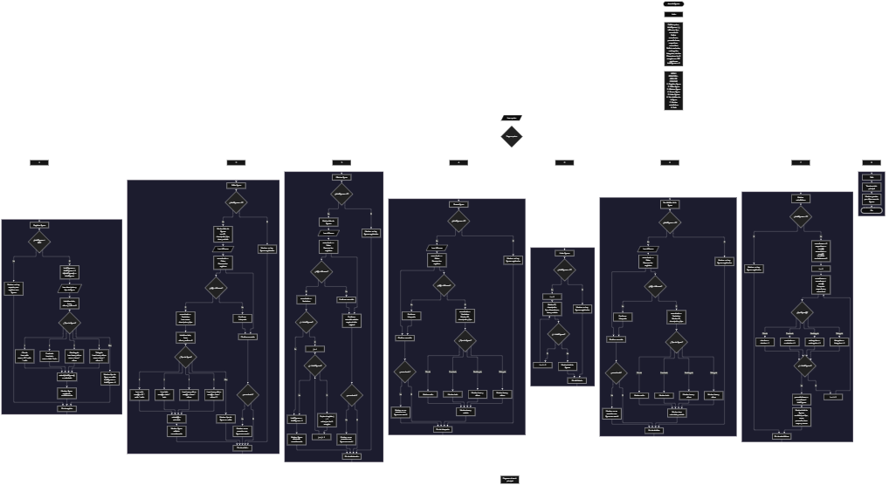

Este proyecto, llamado <b>área de figuras</b>, fue desarrollado en <b>pseint</b> como un ejercicio práctico para fortalecer la lógica de programación mediante la creación de un sistema de gestión y cálculo de áreas geométricas desde la consola. El programa cuenta con un menú principal de ocho opciones que permite <b>registrar, editar, eliminar, buscar, listar y consultar la información completa</b> de las figuras registradas, además de mostrar estadísticas generales. Cada figura almacena un identificador, una descripción, el tipo de figura, las dimensiones correspondientes, el área calculada y su estado, utilizando arreglos con una capacidad máxima de <b>100 figuras durante la ejecución</b>. El sistema permite trabajar con cuatro tipos de figuras geométricas: <b>cuadrados, rectángulos, triángulos y círculos</b>, aplicando las fórmulas matemáticas correspondientes para calcular sus áreas. Durante su desarrollo se aplicaron conceptos fundamentales de programación, como variables, arreglos, estructuras condicionales, ciclos repetitivos y estructuras de selección, además de procesos para buscar, modificar, eliminar y organizar registros. Este proyecto permite poner en práctica los conocimientos adquiridos en PSeInt y sirve como base para desarrollar sistemas de gestión y cálculo más avanzados utilizando otros lenguajes y tecnologías.

<h2 align="center">⚙️ Funcionamiento del menú principal</h2>

### ➕ Registrar figura

La opción <b>1) registrar figura</b> permite registrar una nueva figura geométrica en el sistema. Antes de realizar el registro, el programa comprueba que la cantidad de figuras almacenadas sea menor a <b>100</b>, utilizando la condición <b>totalFiguras &lt; 100</b>. Si existe espacio disponible, la variable <b>totalFiguras</b> aumenta en uno y el programa asigna un identificador utilizando la posición actual del arreglo. Después, solicita una descripción y presenta un menú para seleccionar el tipo de figura: cuadrado, rectángulo, triángulo o círculo. Dependiendo de la selección, solicita las dimensiones necesarias para realizar el cálculo. Para el cuadrado, pide el lado y calcula el área multiplicándolo por sí mismo; para el rectángulo, solicita la base y la altura y multiplica ambos valores; para el triángulo, solicita la base y la altura y divide entre dos el producto de ambas medidas; y para el círculo, solicita el radio y calcula el área multiplicando <b>PI</b> por el radio al cuadrado. Antes de procesar el tipo de figura, inicializa las dimensiones en cero. Si el tipo seleccionado es válido, establece el estado como <b>"calculado"</b> y muestra el mensaje <b>"figura registrada correctamente."</b>. Si el tipo no es válido, presenta el mensaje <b>"tipo de figura no valido."</b> y disminuye el contador de figuras. Si se alcanza la capacidad máxima, muestra el mensaje <b>"no hay espacio para registrar mas figuras."</b>, impidiendo agregar otro registro.

### ✏️ Editar figura

La opción <b>2) editar figura</b> permite modificar la información de una figura geométrica registrada. Primero, el programa comprueba si existen figuras almacenadas mediante la variable <b>totalFiguras</b>. Si no hay registros, muestra el mensaje <b>"no hay figuras registradas."</b>. En caso contrario, presenta una lista con el identificador, la descripción, el tipo de figura, el área y el estado de cada registro. Después, solicita el identificador de la figura que se desea editar y utiliza la variable lógica <b>encontrado</b> para comprobar si existe una coincidencia. Mediante un ciclo <b>para</b>, recorre los identificadores almacenados y compara cada uno con el valor introducido. Cuando encuentra una figura, solicita la nueva descripción y presenta las opciones para seleccionar el nuevo tipo de figura. A continuación, inicializa las dimensiones en cero, solicita las medidas correspondientes y calcula nuevamente el área según el tipo seleccionado. Si el tipo es válido, actualiza el estado a <b>"calculado"</b> y muestra el mensaje <b>"figura editada correctamente."</b>. Si el identificador no corresponde a ninguna figura registrada, presenta el mensaje <b>"no se encontro una figura con ese id."</b>. Si se introduce un tipo de figura no válido, el programa muestra el mensaje correspondiente, pero no restaura automáticamente la descripción ni las dimensiones anteriores, por lo que pueden producirse cambios parciales en el registro.

### 🗑️ Eliminar figura

La opción <b>3) eliminar figura</b> permite eliminar una figura geométrica mediante su identificador. Antes de comenzar, el programa comprueba si existen figuras registradas. Si no hay registros, muestra el mensaje <b>"no hay figuras registradas."</b>. Si existen figuras, presenta una lista con el identificador, la descripción, el tipo de figura, el área y el estado de cada una. Después, solicita el identificador de la figura que se desea eliminar e inicializa la variable lógica <b>encontrado</b> con el valor <b>falso</b>. Mediante un ciclo <b>para</b>, recorre los registros hasta encontrar una coincidencia. Cuando localiza el identificador, cambia la variable <b>encontrado</b> a <b>verdadero</b> y, si la figura no ocupa la última posición, utiliza otro ciclo <b>para</b> controlado por la variable <b>j</b> para desplazar una posición hacia atrás los datos de los arreglos <b>id, descripcion, tipoFigura, lado, base, altura, radio, area y estado</b>. Posteriormente, disminuye la variable <b>totalFiguras</b> en uno y muestra el mensaje <b>"figura eliminada correctamente."</b>. Si el identificador no se encuentra, presenta el mensaje <b>"no se encontro una figura con ese id."</b>. El código no limpia explícitamente la última posición después del desplazamiento ni interrumpe el ciclo exterior tras encontrar una coincidencia.

### 🔎 Buscar figura

La opción <b>4) buscar figura</b> permite localizar una figura geométrica mediante su identificador. Primero, el programa comprueba si existen figuras registradas. Si no hay registros, muestra el mensaje <b>"no hay figuras registradas."</b>. En caso contrario, solicita el identificador de la figura que se desea buscar e inicializa la variable lógica <b>encontrado</b> con el valor <b>falso</b>. A continuación, utiliza un ciclo <b>para</b> para recorrer los identificadores almacenados y compararlos con el valor introducido. Cuando encuentra una coincidencia, cambia la variable <b>encontrado</b> a <b>verdadero</b> y muestra los datos de la figura, incluyendo el identificador, la descripción, el tipo de figura, las dimensiones correspondientes, el área calculada y el estado. Para mostrar las dimensiones, utiliza estructuras condicionales que determinan qué medidas corresponden al tipo de figura registrado. Si se trata de un cuadrado, muestra el lado; si es un rectángulo o un triángulo, presenta la base y la altura; y si es un círculo, muestra el radio. Si finaliza el recorrido sin encontrar el identificador solicitado, presenta el mensaje <b>"no se encontro una figura con ese id."</b>.

### 📋 Listar figuras

La opción <b>5) listar figuras</b> permite visualizar todas las figuras geométricas registradas en el sistema. Antes de mostrar los datos, el programa comprueba si la variable <b>totalFiguras</b> es igual a cero. Si no existen registros, presenta el mensaje <b>"no hay figuras registradas."</b>. Si hay figuras disponibles, muestra el encabezado de la lista y utiliza un ciclo <b>para</b> para recorrer los arreglos desde la primera posición hasta el total de figuras registradas. Durante cada repetición, muestra el identificador, la descripción, el tipo de figura, las dimensiones correspondientes, el área calculada y el estado. Las dimensiones se presentan mediante condiciones que dependen del tipo de figura almacenado. Al finalizar el recorrido, muestra el total de figuras registradas utilizando la variable <b>totalFiguras</b>. Esta función facilita consultar los registros existentes sin necesidad de buscar cada figura individualmente.

### 📄 Ver detalles de la figura

La opción <b>6) ver detalles de la figura</b> permite consultar la información completa de una figura específica. Primero, el programa comprueba si existen figuras registradas. Si no hay registros, muestra el mensaje <b>"no hay figuras registradas."</b>. En caso contrario, solicita el identificador de la figura que se desea consultar e inicializa la variable lógica <b>encontrado</b> con el valor <b>falso</b>. Después, recorre los identificadores mediante un ciclo <b>para</b> y compara cada uno con el valor introducido. Cuando encuentra una coincidencia, establece <b>encontrado</b> en <b>verdadero</b> y muestra los detalles de la figura: identificador, descripción, tipo, dimensiones correspondientes, área calculada y estado. Para presentar las medidas, utiliza estructuras condicionales que permiten mostrar el lado de los cuadrados, la base y la altura de los rectángulos y triángulos, y el radio de los círculos. Si el identificador no corresponde a ninguna figura registrada, muestra el mensaje <b>"no se encontro una figura con ese id."</b>. Esta opción permite consultar individualmente las características y el resultado del cálculo geométrico.

### 📊 Mostrar estadísticas

La opción <b>7) mostrar estadísticas</b> permite obtener información general sobre las figuras registradas. Primero, el programa comprueba si existen registros. Si la colección está vacía, muestra el mensaje <b>"no hay figuras registradas."</b>. En caso contrario, inicializa <b>sumaAreas</b> en cero y utiliza el área de la primera figura para establecer los valores iniciales de <b>mayorArea</b> y <b>menorArea</b>. También inicializa en cero los contadores <b>cuadrados, rectangulos, triangulos y circulos</b>. A continuación, recorre las figuras mediante un ciclo <b>para</b>, acumula sus áreas y compara cada valor para determinar el área mayor y la menor. Mediante una estructura <b>segun</b>, identifica el tipo de cada figura y aumenta el contador correspondiente. Al finalizar el recorrido, calcula el promedio de las áreas dividiendo <b>sumaAreas</b> entre <b>totalFiguras</b>. Finalmente, muestra el total de figuras, las cantidades registradas por tipo, la suma de las áreas, el promedio, el área mayor y el área menor. Estas estadísticas permiten conocer la distribución de las figuras y comparar sus superficies.

### 🚪 Salir del menú principal

La opción <b>8) salir</b> está destinada a finalizar la ejecución del programa y muestra el mensaje <b>"gracias por utilizar area de figuras."</b>. El menú principal se encuentra dentro de una estructura repetitiva <b>repetir ... hasta que</b>, que mantiene el programa en funcionamiento mientras se realizan las operaciones disponibles. En este caso, la condición final es <b>hasta que opcion = 8</b>, por lo que seleccionar la opción 8 termina el ciclo y permite finalizar el algoritmo. Si el usuario introduce un valor que no corresponde a ninguna opción del menú, la estructura <b>segun</b> ejecuta el bloque <b>de otro modo</b> y muestra el mensaje <b>"opcion no valida."</b>.

<h2 align="center">🧠 Temas aplicados en el proyecto</h2>

### 📦 Variables

En este proyecto se utilizan variables para controlar las opciones del menú, administrar la cantidad de figuras registradas, recorrer los arreglos, localizar identificadores, almacenar las dimensiones geométricas y calcular las estadísticas generales. Cada variable cumple una función específica dentro de las operaciones del sistema y permite organizar los datos necesarios para gestionar las figuras.

🔢 <b>Opcion:</b> Almacena la opción seleccionada por el usuario en el menú principal.

📊 <b>TotalFiguras:</b> Controla la cantidad actual de figuras registradas.

🔄 <b>I:</b> Funciona como contador en los ciclos <b>para</b> y permite recorrer las posiciones de los arreglos.

🔁 <b>J:</b> Controla el recorrido utilizado para desplazar los datos durante la eliminación de una figura.

🔎 <b>IdBuscar:</b> Almacena el identificador introducido por el usuario para localizar una figura.

🔢 <b>Tipo:</b> Almacena la opción numérica seleccionada para determinar el tipo de figura geométrica.

✅ <b>Encontrado:</b> Variable lógica que indica si se encontró el identificador solicitado.

📐 <b>Lado, base, altura y radio:</b> Almacenan las dimensiones utilizadas para calcular el área de las figuras.

🧮 <b>Area:</b> Almacena el área calculada de cada figura registrada.

📈 <b>SumaAreas:</b> Acumula las áreas de las figuras para obtener la suma general.

📊 <b>PromedioAreas:</b> Almacena el promedio de las áreas calculadas.

🏆 <b>MayorArea y menorArea:</b> Almacenan el área mayor y el área menor encontradas durante el cálculo de estadísticas.

🔷 <b>Cuadrados, rectangulos, triangulos y circulos:</b> Cuentan las figuras registradas según su tipo.

### 🗃️ Arreglos

En este proyecto se utilizan nueve arreglos relacionados con la información de cada figura geométrica. Cada arreglo tiene una capacidad de <b>100 posiciones</b> y utiliza el mismo índice para representar los datos correspondientes a una misma figura. Por ejemplo, los datos de una figura almacenada en la posición <b>1</b> se encuentran distribuidos entre <b>id[1], descripcion[1], tipoFigura[1], lado[1], base[1], altura[1], radio[1], area[1] y estado[1]</b>. Esta organización permite recorrer, buscar, modificar, mostrar y eliminar las figuras manteniendo relacionados sus datos.

🆔 <b>Id[100]:</b> Almacena los identificadores de las figuras registradas.

📝 <b>Descripcion[100]:</b> Almacena las descripciones de las figuras geométricas.

🔷 <b>TipoFigura[100]:</b> Identifica el tipo de figura: cuadrado, rectángulo, triángulo o círculo.

📏 <b>Lado[100]:</b> Guarda la medida del lado de los cuadrados.

↔️ <b>Base[100]:</b> Almacena la base de los rectángulos y los triángulos.

↕️ <b>Altura[100]:</b> Guarda la altura de los rectángulos y los triángulos.

⭕ <b>Radio[100]:</b> Almacena el radio de los círculos.

🧮 <b>Area[100]:</b> Guarda el área calculada de cada figura.

📌 <b>Estado[100]:</b> Almacena el estado de la figura, que se establece como <b>"calculado"</b> cuando el registro se crea correctamente o se edita con un tipo válido.

### 🔀 Estructuras condicionales

En este proyecto se utilizan las estructuras <b>si</b> y <b>sino</b> para comprobar diferentes condiciones durante la ejecución del programa. Estas estructuras permiten verificar si existe espacio disponible antes de registrar una figura, determinar si hay registros antes de realizar una operación, comprobar si se encontró el identificador solicitado, seleccionar las dimensiones que deben mostrarse según el tipo de figura y comparar las áreas para encontrar el valor mayor y el menor. También se utilizan para comprobar si el tipo seleccionado se encuentra entre las opciones válidas y determinar cuándo se debe mostrar un mensaje de error.

### 🔄 Estructuras repetitivas

En este proyecto se utilizan los ciclos <b>para</b> y <b>repetir ... hasta que</b>. Los ciclos <b>para</b> permiten recorrer los arreglos para editar, eliminar, buscar, listar y consultar las figuras, además de calcular las estadísticas generales. Durante la eliminación, se utiliza un ciclo adicional para desplazar los datos de los registros posteriores hacia las posiciones anteriores. Por otro lado, el ciclo <b>repetir ... hasta que</b> mantiene activo el menú principal para que el usuario pueda ejecutar las operaciones disponibles hasta seleccionar la opción <b>8) salir</b>.

### 🎯 Estructura según

La estructura <b>segun</b> evalúa el valor almacenado en la variable <b>opcion</b> y ejecuta el bloque de instrucciones correspondiente a cada operación del menú principal. Los casos del 1 al 8 representan el registro, la edición, la eliminación, la búsqueda, el listado, la consulta de detalles, las estadísticas y la salida del programa. También se utiliza otra estructura <b>segun</b> durante el registro, la edición y el cálculo de estadísticas para determinar el tipo de figura y ejecutar las instrucciones correspondientes. El bloque <b>de otro modo</b> permite mostrar un mensaje cuando el usuario selecciona un tipo de figura no válido o introduce una opción que no corresponde al menú.

### 🔢 Dimensionamiento de arreglos

El programa utiliza la instrucción <b>dimension</b> para establecer la capacidad de los arreglos que almacenan la información de las figuras. Se definieron <b>100 posiciones</b> para cada uno de los nueve arreglos, lo que permite administrar hasta 100 figuras durante la ejecución. La cantidad de registros ocupados se controla mediante la variable <b>totalFiguras</b>, que también se utiliza para comprobar la disponibilidad de espacio y limitar los recorridos a las posiciones correspondientes a los registros actuales.

### 🔄 Reorganización de registros

Cuando se elimina una figura, el programa utiliza un ciclo <b>para</b> controlado por la variable <b>j</b> para desplazar los datos de las posiciones posteriores una posición hacia atrás. Este proceso se aplica a los arreglos <b>id, descripcion, tipoFigura, lado, base, altura, radio, area y estado</b>. Después, disminuye la variable <b>totalFiguras</b> en uno para actualizar la cantidad de registros. El código no limpia explícitamente la última posición después del desplazamiento ni detiene el ciclo exterior después de encontrar una coincidencia, por lo que la reorganización refleja el funcionamiento actual del algoritmo.

<h2 align="center">¿Cómo se implementaron las operaciones crud en el proyecto?</h2>

Las operaciones <b>crud</b> se implementaron mediante las opciones del menú principal, permitiendo administrar las figuras geométricas registradas. La operación <b>crear</b> corresponde a <b>registrar figura</b>, donde se introducen la descripción, el tipo y las dimensiones necesarias para calcular el área. La operación <b>leer</b> se realiza mediante las opciones <b>buscar figura, listar figuras y ver detalles de la figura</b>, que permiten consultar la información almacenada. La operación <b>actualizar</b> corresponde a <b>editar figura</b>, donde se modifican los datos y se recalcula el área cuando se selecciona un tipo válido. Finalmente, la operación <b>eliminar</b> se realiza mediante <b>eliminar figura</b>, que retira el registro seleccionado y desplaza los datos posteriores cuando corresponde. Estas operaciones utilizan variables, arreglos, estructuras condicionales y ciclos para administrar la información almacenada temporalmente durante la ejecución del programa.

<h2 align="center">Diagrama de flujo del proyecto</h2>

<h2 align="center">🛡️ Validaciones del programa</h2>

### 📭 No existen figuras registradas

Esta validación se utiliza en las opciones de <b>editar, eliminar, buscar, listar, ver detalles y mostrar estadísticas</b>. El programa comprueba si la variable <b>totalFiguras</b> es igual a <b>0</b> y, si no existen figuras registradas, muestra el mensaje <b>"no hay figuras registradas."</b>. Esta comprobación evita continuar con las operaciones que necesitan información almacenada cuando la colección está vacía.

### ⚠️ Capacidad máxima alcanzada

Esta validación se utiliza durante el registro de figuras para controlar la capacidad de los arreglos. El programa comprueba si <b>totalFiguras &lt; 100</b> antes de permitir un nuevo registro. Si existe espacio disponible, aumenta el contador y solicita los datos de la figura. En caso contrario, muestra el mensaje <b>"no hay espacio para registrar mas figuras."</b>, impidiendo agregar otro registro cuando se ha alcanzado el límite establecido.

### ❌ Tipo de figura no válido

Durante el registro y la edición, el programa utiliza una estructura <b>segun</b> para procesar las opciones del 1 al 4, correspondientes al cuadrado, rectángulo, triángulo y círculo. Si se introduce otro valor, muestra el mensaje <b>"tipo de figura no valido."</b>. Durante el registro, también disminuye el contador de figuras; durante la edición, no restaura automáticamente los datos anteriores. Por tanto, existe una comprobación del tipo seleccionado, pero no se garantiza que todos los datos de una figura editada permanezcan sin cambios cuando la selección es inválida.

### 🔎 Figura no encontrada

Esta validación se utiliza durante las operaciones de <b>editar, eliminar, buscar y ver detalles</b>. El programa inicializa la variable lógica <b>encontrado</b> con el valor <b>falso</b> y recorre los identificadores almacenados para compararlos con el valor introducido por el usuario. Cuando encuentra una coincidencia, cambia la variable a <b>verdadero</b> y ejecuta la operación correspondiente. Si finaliza el recorrido sin encontrar el identificador, muestra el mensaje <b>"no se encontro una figura con ese id."</b>. Esta comprobación permite informar al usuario cuando la figura solicitada no está registrada.

### 📐 Cálculo de áreas

El programa selecciona una fórmula matemática según el tipo de figura elegido. Para el cuadrado, multiplica el lado por sí mismo; para el rectángulo, multiplica la base por la altura; para el triángulo, divide entre dos el producto de la base por la altura; y para el círculo, multiplica <b>PI</b> por el radio al cuadrado. Sin embargo, el código no comprueba que las dimensiones introducidas sean positivas, por lo que permite realizar los cálculos con valores negativos o cero. Las fórmulas se ejecutan con los valores proporcionados por el usuario, sin una validación adicional de las medidas.

### 🔢 Identificadores de las figuras

El programa asigna los identificadores mediante la instrucción <b>id[totalFiguras] &lt;- totalFiguras</b>. Esto permite identificar cada figura registrada utilizando su posición al momento de crearla. Sin embargo, después de eliminar una figura, el contador disminuye y puede volver a coincidir con un identificador existente. Por este motivo, el código actual no garantiza que todos los identificadores permanezcan únicos durante toda la ejecución del programa.

### ⚠️ Opción inválida

La estructura <b>segun</b> del menú principal incluye el bloque <b>de otro modo</b>, que muestra el mensaje <b>"opcion no valida."</b> cuando el usuario introduce un número que no corresponde a las opciones definidas. El menú contempla las opciones del <b>1 al 8</b>, y la opción <b>8</b> permite finalizar el ciclo principal. Esta comprobación informa sobre una selección incorrecta, aunque no incluye una validación adicional para restringir la entrada a números enteros dentro del rango permitido antes de leer la opción.

### 💾 Almacenamiento temporal

La información de las figuras se almacena en los arreglos durante la ejecución del programa. El código no incluye instrucciones para guardar los registros en archivos ni en una base de datos, por lo que la información no se conserva automáticamente después de finalizar el algoritmo. La gestión de los datos se realiza mediante la variable <b>totalFiguras</b> y los arreglos paralelos, que permiten registrar, consultar, modificar y eliminar figuras mientras el programa permanece en ejecución.

<h2 align="center">🎯 Objetivo del proyecto</h2>

El objetivo principal de este proyecto es fortalecer la <b>lógica de programación</b> mediante el desarrollo de un sistema de gestión y cálculo de áreas geométricas en <b>pseint</b>. A través de su construcción se busca aplicar los conocimientos adquiridos sobre variables, arreglos, estructuras condicionales, ciclos repetitivos y estructuras de selección, integrándolos para resolver un problema de manera organizada. Además, el proyecto permite comprender cómo implementar fórmulas matemáticas para calcular las áreas de cuadrados, rectángulos, triángulos y círculos, así como desarrollar operaciones para registrar, consultar, modificar, eliminar y analizar información. De esta manera, el sistema sirve como una base para desarrollar aplicaciones de consola más completas y continuar fortaleciendo los conocimientos de programación mediante otros lenguajes y tecnologías.

